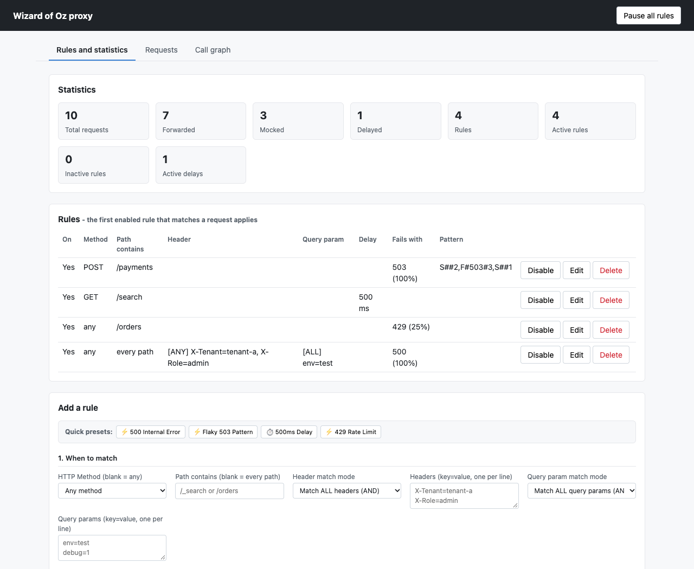
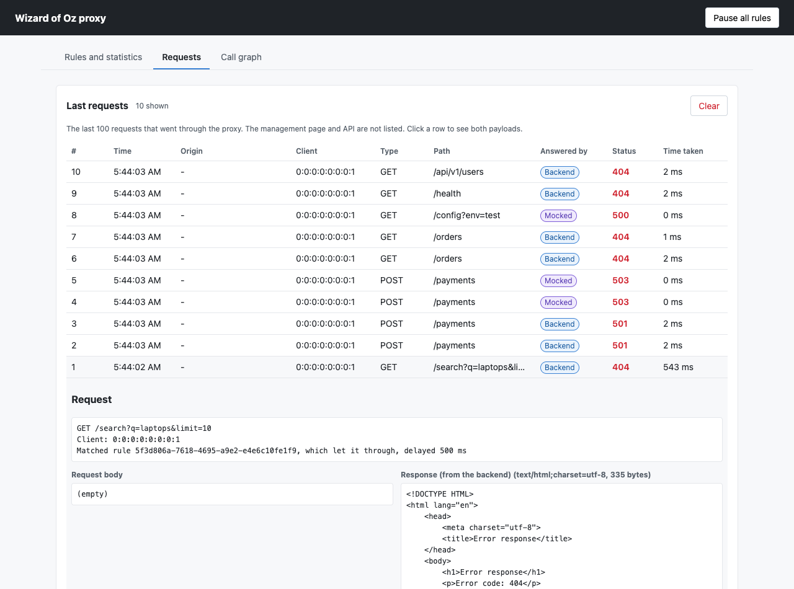
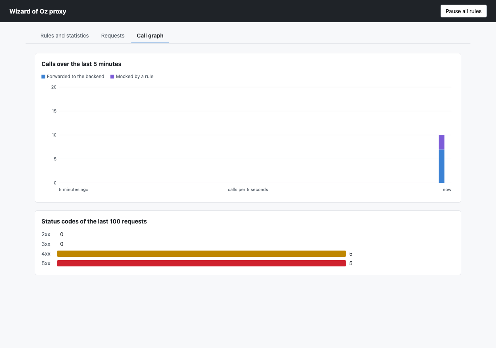

# Wizard of Oz proxy

A high-performance, developer-friendly HTTP proxy that sits in front of any backend service and misbehaves on purpose. Point your application at the proxy instead of the real backend, then configure rules to simulate real-world failure scenarios: latency spikes, intermittent outages, deterministic retry sequences, custom error codes, and rate limits.

Use it to validate how your client and instrumentation stacks handle upstream dependencies under adverse conditions: timeouts, retries, fallback logic, circuit breakers, and error alerting.



---

## Key Features

- **Precise Request Matching:** Match requests by HTTP method, URL path substring, multi-header key/value pairs (`ALL`/`ANY` matching modes), and query parameters (`ALL`/`ANY` matching modes).
- **Chaos & Fault Injection:**
  - **Latency Simulation:** Configurable delay (`delayMs`) before forwarding or answering.
  - **Mock Responses:** Injected status codes, custom response bodies, and Content-Type headers.
  - **Probabilistic Failures:** Percentage-based failure rate (`errorProbability: 0-100`).
  - **Deterministic Error Patterns:** Repeatable sequences of successes and failures (e.g., `S##2,F#503#3,S##1`) that hold under concurrent load.
- **Permanent SQLite Storage:** Rules persist across restarts in a lightweight SQLite database (`rules.db`) with asynchronous background synchronization, zero in-memory matching overhead, and graceful permission fallback.
- **Interactive Management UI:**
  - **Rules & Statistics:** Live rule editor, quick presets, rule reordering, enable/disable toggles, global pause/resume, and real-time counters.
  - **Request Inspector:** Real-time log of the last 100 requests with client IP, Origin, headers, matched rule ID, response status, duration, and inspectable request/response payloads (with automatic gzip decompression).
  - **Call Graph & Metrics:** Real-time traffic rate graph (forwarded vs. mocked) and HTTP status class breakdown.
- **Clean Protocol Relay:** Forwarded requests and responses strip hop-by-hop headers according to HTTP specifications while supporting headers up to 1 MB and streaming payloads without alteration.

---

## Rule Configuration

For every incoming request, the proxy evaluates enabled rules in top-to-bottom order and applies the first matching rule. If no rule matches (or when the proxy is paused), the request is forwarded to the upstream target backend untouched.

### Rule Settings

| Setting | Type | Default | Description |
|---|---|---|---|
| `enabled` | boolean | `true` | Whether the rule is active. Disabled rules are skipped during evaluation. |
| `method` | string | `""` | HTTP method to match (`GET`, `POST`, `PUT`, `DELETE`, `PATCH`, `HEAD`, `OPTIONS`, `TRACE`). Blank matches any method. |
| `pathContains` | string | `""` | Substring that must be present in the request URI path. Blank matches any path. |
| `headers` | object | `{}` | Key-value map of headers to match (case-insensitive keys). Example: `{"X-Tenant": "tenant-a", "X-Role": "admin"}`. |
| `headerMatchMode` | string | `"ALL"` | `"ALL"` (AND: all headers must match) or `"ANY"` (OR: at least one header must match). |
| `queryParams` | object | `{}` | Key-value map of query parameters to match. Example: `{"env": "test", "debug": "true"}`. |
| `queryParamMatchMode` | string | `"ALL"` | `"ALL"` (AND: all query parameters must match) or `"ANY"` (OR: at least one query parameter must match). |
| `headerName`, `headerValue` | string | `null` | Convenience fields for single-header matching (also accepted as `headerKey`). |
| `queryParamName`, `queryParamValue` | string | `null` | Convenience fields for single query-parameter matching (also accepted as `queryParamKey`). |
| `delayMs` | integer | `0` | Milliseconds to wait before responding or forwarding. |
| `responseStatus` | integer | `null` | HTTP status code to answer with. When omitted, matching requests are delayed and forwarded to the backend. |
| `responseBody` | string | `""` | Response body to return when mocking a response. |
| `contentType` | string | `"application/json"` | `Content-Type` header for the mocked response. |
| `errorProbability` | integer | `100` | Percentage (0–100) of matching requests that receive the mocked error; remaining requests are forwarded. |
| `errorPattern` | string | `""` | Deterministic run pattern sequence (e.g. `S##2,F#503#3,S##1`). |

---

### Deterministic Error Patterns

Random failures cause flaky integration tests. Error patterns allow you to define an exact, reproducible sequence of successes and failures.

A pattern consists of a comma-separated list of runs:
- `S##<count>`: Forward `<count>` matching requests to the upstream backend.
- `F#<status>#<count>`: Intercept and answer `<count>` matching requests with HTTP `<status>`.

**Example:** `S##2,F#503#3,S##1`
1. The first **2** requests succeed (forwarded to backend).
2. The next **3** requests fail with `503 Service Unavailable`.
3. The next **1** request succeeds (forwarded).
4. After the last run finishes, the final run repeats indefinitely. A pattern ending in `S##1` permanently recovers, whereas one ending in `F#500#1` fails indefinitely.

Positions within a pattern are handed out atomically, guaranteeing strict determinism even under high concurrent load (e.g., 200 concurrent requests against `S##10,F#503#3,S##1` will produce exactly 3 failures).

---

## Management UI

Access the interactive web UI at `http://localhost:8080/wizoz/ui`.

### 1. Rules and Statistics
- Configure and test fault injection rules with built-in **Quick Presets** (`⚡ 500 Internal Error`, `⚡ Flaky 503 Pattern`, `⏱️ 500ms Delay`, `⚡ 429 Rate Limit`).
- Reorder, edit, delete, or toggle individual rules.
- Global **Pause all rules / Resume rules** button to temporarily bypass all fault injection without losing rules.
- Live database status banner alerting if filesystem permissions prevent SQLite persistence.


### 2. Request Inspector
- Logs the last 100 requests through the proxy with timestamp, method, path, query, client IP, Origin, matched rule ID, delay, status, and duration.
- Click any row to expand full **Request Body** and **Response Body** views (with automatic gzip decompression).
- Click **Clear** (`DELETE /wizoz/requests`) to purge stored request logs.



### 3. Call Graph & Metrics
- Rolling 5-minute traffic visualization (requests per 5 seconds, split into forwarded vs. mocked).
- Status code distribution across recent requests (2xx, 3xx, 4xx, 5xx).



---

## Permanent Rule Storage (SQLite)

Rules are automatically stored in an embedded SQLite database:

- **Startup Loading:** Persisted rules are loaded into memory when the application starts. If the database file does not exist, it is generated automatically in the configured path (`rules.db` by default).
- **Zero Request-Path Overhead:** Rule evaluation on live traffic is performed entirely in-memory (`CopyOnWriteArrayList`) with zero per-request database query overhead.
- **Asynchronous Synchronization:** Rule creations, updates, deletes, and toggles are enqueued and written to SQLite in the background by a dedicated worker thread.
- **Shutdown Flush:** When the application stops, both Spring's `@PreDestroy` and a JVM shutdown hook cleanly flush all pending rules from memory to disk.
- **Permission Fallback:** If the database file or directory cannot be written to due to filesystem permissions, the application does not crash; it operates in in-memory mode and displays a warning banner in the UI and `/wizoz/statistics` API.

---

## Configuration Properties

Configure settings via `application.yml`, Java system properties, or environment variables:

| Property | Environment Variable | Default | Description |
|---|---|---|---|
| `wizoz.proxy.target-url` | `WIZOZ_PROXY_TARGET_URL` | `http://localhost:8888` | The upstream backend URL to forward traffic to. Trailing slashes are automatically normalized. |
| `wizoz.proxy.request-timeout` | `WIZOZ_PROXY_REQUEST_TIMEOUT` | `30s` | Upstream timeout duration. Timeouts return `504 Gateway Timeout`; unreachable targets return `502 Bad Gateway`. |
| `wizoz.proxy.database-path` | `WIZOZ_PROXY_DATABASE_PATH` | `rules.db` | File path for SQLite rule persistence. Use `:memory:` for purely in-memory test runs. |
| `server.port` | `PORT` / `SERVER_PORT` | `8080` | Port the proxy listens on. |
| `server.max-http-request-header-size` | — | `1MB` | Maximum allowed request header size. |

---

## Management REST API

All proxy management endpoints are prefixed with `/wizoz` and are never forwarded to the backend.

| Method | Endpoint | Description |
|---|---|---|
| `GET` | `/wizoz/rules` | List all configured rules in evaluation order. |
| `POST` | `/wizoz/rules` | Create a new rule. Returns the created rule with its generated `id`. |
| `GET` | `/wizoz/rules/{id}` | Retrieve details for a specific rule. |
| `PUT` | `/wizoz/rules/{id}` | Update an existing rule while preserving its position in the list. |
| `DELETE` | `/wizoz/rules/{id}` | Delete a specific rule. |
| `DELETE` | `/wizoz/rules` | Delete all rules. |
| `POST` | `/wizoz/rules/{id}/enable` | Enable a specific rule. |
| `POST` | `/wizoz/rules/{id}/disable` | Disable a specific rule. |
| `POST` | `/wizoz/pause` | Pause rule evaluation (all traffic is forwarded unchanged). |
| `POST` | `/wizoz/resume` | Resume rule evaluation. |
| `GET` | `/wizoz/statistics` | Retrieve real-time request counts, rule statistics, pause status, and DB warning state. |
| `GET` | `/wizoz/statistics/timeline` | Retrieve 5-minute time-bucketed request metrics. |
| `GET` | `/wizoz/requests` | Retrieve the last 100 logged requests with payload details. |
| `DELETE` | `/wizoz/requests` | Clear stored request history. |
| `GET` | `/wizoz/ui` | Interactive management web UI. |

---

## Examples

### 1. Intermittent / Flaky Failures (Error Pattern)
Fail POST requests to `/payments`: 2 succeed, 3 fail with 503, then recover:
```bash
curl -X POST http://localhost:8080/wizoz/rules \
  -H 'Content-Type: application/json' \
  -d '{
    "method": "POST",
    "pathContains": "/payments",
    "errorPattern": "S##2,F#503#3,S##1"
  }'
```

### 2. Inject Latency
Add a 500 ms delay to all `/search` queries:
```bash
curl -X POST http://localhost:8080/wizoz/rules \
  -H 'Content-Type: application/json' \
  -d '{
    "pathContains": "/search",
    "delayMs": 500
  }'
```

### 3. Rate Limiting Simulation
Simulate a 429 Too Many Requests response on 25% of requests to `/orders`:
```bash
curl -X POST http://localhost:8080/wizoz/rules \
  -H 'Content-Type: application/json' \
  -d '{
    "pathContains": "/orders",
    "responseStatus": 429,
    "errorProbability": 25,
    "responseBody": "{\"error\": \"Too many requests, please retry later\"}"
  }'
```

### 4. Multi-Header & Query Parameter Matching
Match requests with specific headers and query parameters:
```bash
curl -X POST http://localhost:8080/wizoz/rules \
  -H 'Content-Type: application/json' \
  -d '{
    "headers": {
      "X-Tenant": "tenant-a",
      "X-Role": "admin"
    },
    "headerMatchMode": "ALL",
    "queryParams": {
      "env": "staging",
      "debug": "true"
    },
    "queryParamMatchMode": "ANY",
    "responseStatus": 500,
    "responseBody": "{\"error\": \"Injected fault for staging admin\"}"
  }'
```

---

## Build and Run

### Prerequisites
- **Java 17** or higher
- **Maven 3.8+** (or use the included `./mvnw` wrapper)

### Build
```bash
./mvnw clean package
```

### Run
```bash
java -jar target/wizard-of-oz-proxy-0.0.1-SNAPSHOT.jar \
  --wizoz.proxy.target-url=https://api.example.com \
  --server.port=8080
```

Open your browser at `http://localhost:8080/wizoz/ui` to start creating rules.

---

## Running Tests

Run the full suite of unit and integration tests:
```bash
./mvnw test
```

The test suite validates:
- Rule validation, normalization, and precedence ordering.
- Multi-header and query parameter matching with `ALL` and `ANY` modes.
- Deterministic error pattern execution under high concurrent load.
- End-to-end proxying against live HTTP backends with form posts, streaming JSON, large headers, and error scenarios.
- SQLite rule persistence, async sync, startup restoration, and permission fallback handling.

---

## License

Distributed under the [MIT License](LICENSE).
